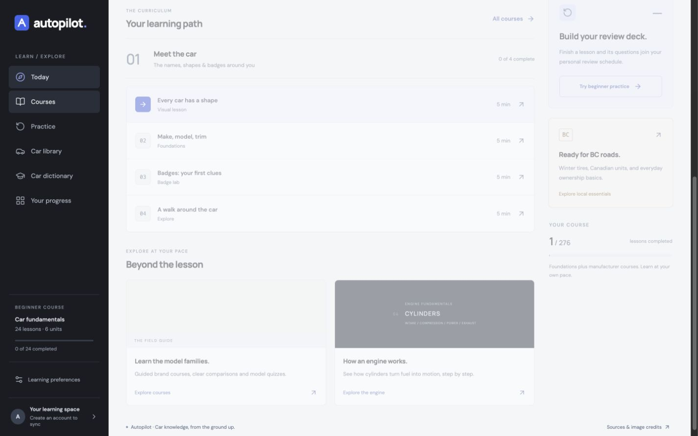
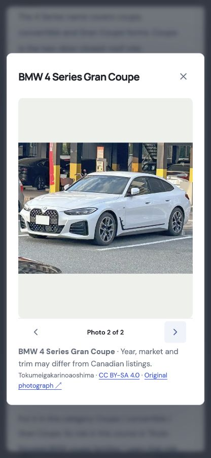

# Autopilot

A visual car school for complete beginners, built around the cars seen on Canadian roads.

[Open the app](https://autopilot-car-school.vercel.app) · [Getting started](#run-locally) · [Architecture](docs/architecture.md) · [Deployment](docs/deployment.md) · [Contributing](CONTRIBUTING.md)



## Learn the names. Recognize the cars. Understand the differences.

Autopilot starts with shapes, badges, engines and fuel, then introduces individual manufacturers and their model families. Plain-language explanations, worked examples, photo activities and quizzes help connect a car's name with what it does and why someone might choose it.

| Learn | Put it into practice |
| --- | --- |
| Car fundamentals | 24 lessons covering shapes, names, badges, cylinders, powertrains and Canadian ownership basics |
| Manufacturer courses | 25 brands, including 19 detailed tracks, with 166 model-family guides |
| Visual recognition | 214 credited reference photos, labelled galleries, enlargement and picture quizzes |
| Lasting recall | Spaced review, matching activities, XP, levels, streaks and a flexible daily goal |
| Canadian comparisons | Official fuel-consumption records, exact year/trim/powertrain comparisons and saved cars |
| Saved progress | Guest persistence, Supabase accounts, cloud sync, retry and import/export backups |

The current edition contains **276 lessons and 1,394 quiz questions**. Lessons and photos are curated; live catalogue updates do not automatically rewrite the curriculum.

<details>
<summary>See a model-family photo gallery</summary>



The galleries distinguish related models and body styles. Photographs retain their full frame, and the enlarged view fits phones, desktops and landscape screens. Reference years, markets and trims can differ from a particular Canadian catalogue record.

</details>

## Technology

- **React 19, TypeScript and Vite** for the application.
- **Supabase Auth and Postgres** for accounts and private progress records.
- **Vercel** for the frontend and the Canadian catalogue API.
- **Radix UI, Motion, Lucide, Recharts and Sonner** for accessible interactions, restrained motion, icons, charts and feedback.
- **Natural Resources Canada** for vehicle ratings; **Wikimedia Commons** for credited photography; **Cardog Icons** for brand emblems.

## Run locally

Use **Node.js 24** and npm. Supabase is optional for guest-only development.

```bash
git clone https://github.com/alinikan/autopilot-car-school.git
cd autopilot-car-school
nvm use
npm ci
cp .env.example .env.local
npm run dev
```

Open the local address printed by Vite. To enable accounts and cloud sync, fill in `.env.local` using your Supabase project's URL and **publishable** key:

```dotenv
VITE_SUPABASE_URL=https://your-project.supabase.co
VITE_SUPABASE_PUBLISHABLE_KEY=your-publishable-key
```

Apply [supabase/schema.sql](supabase/schema.sql) **once to a new intended project**, then configure the app origin and allowed authentication redirect URLs in Supabase. The bootstrap SQL creates policies and a trigger; it is not a migration to rerun over an existing deployment. See the [deployment guide](docs/deployment.md) for email-link and production configuration.

Only public client configuration belongs in `VITE_*` variables. Local environment files are ignored by Git. The app does not need a Supabase service-role key.

## Commands

| Command | Purpose |
| --- | --- |
| `npm run dev` | Start Vite and the local catalogue API middleware |
| `npm test` | Check review scheduling, BC dates, backups, catalogue parsing, course integrity, photo coverage and existing question answers |
| `npm run build` | Type-check and build the production application |
| `npm run preview` | Serve the built frontend; use `npm run dev` for the local catalogue API |
| `npm run verify:photos -- https://autopilot-car-school.vercel.app` | Check all hosted photo responses against the local asset hashes |
| `python3 scripts/refresh-catalog.py` | Refresh the included government-data snapshot |

GitHub Actions runs the tests and production build on pushes and pull requests. Its workflow has read-only repository permissions and uses no deployment credentials.

## Project layout

```text
src/                       React UI, course content and learning logic
  academy-data.json        Manufacturer and model-family teaching content
  academy.ts               Builds lessons and stable review questions
  photo-manifest.json      Pictured identities, local files and source credits
  CarPhoto.tsx             Shared full-frame photos, galleries and enlarged views
  learning.mjs             Progress, scheduling and BC-date calculations
  useProgress.ts           Device persistence and Supabase sync
api/catalog.js             Vercel API for official Canadian ratings
public/cars/               Locally hosted, optimized reference photographs
public/brands/             Brand reference assets and attribution
supabase/schema.sql        New-project database bootstrap and ownership policies
scripts/                   Snapshot refresh and deployed-photo verification
tests/                     Node test suite and answer-compatibility fixtures
docs/                      Architecture, deployment, content guide and screenshots
.github/                   CI, dependency updates and contribution templates
```

## Content, data and scope

The course covers selected manufacturers and model families, including labelled earlier or non-Canadian examples. It is a learning curriculum, not an exhaustive worldwide vehicle catalogue. “Better” is explained in terms of a specific use, version and trade-off, not a universal brand ranking.

The vehicle library uses [Natural Resources Canada's fuel-consumption ratings](https://open.canada.ca/data/en/dataset/98f1a129-f628-4ce4-b24d-6f16bf24dd64) and an included fallback snapshot. Exact trims and powertrains can be separate records. Standardized ratings are not guaranteed real-world results. Manufacturer prices are dated Canadian examples with their source and exclusions; they are not live dealer quotes.

Photo identity, photographer, licence and source links are recorded in [src/photo-manifest.json](src/photo-manifest.json) and [public/image-credits.json](public/image-credits.json), and displayed inside the app. Images are resized and compressed without layout cropping. Read [the content guide](docs/content-and-photography.md) before adding or replacing one.

## Progress and account behaviour

Guest progress stays on the device. On first account use, local progress initializes a missing cloud record. An existing cloud record loads on sign-in; newer unsynced device changes are retained. Saves happen locally first, then sync after a short debounce. Cloud failures expose a retry action. Concurrent devices use the most recently written whole progress record, rather than merging individual fields.

Authentication is handled by Supabase; the app offers email-link access and password flows. Deliverability, sending limits and custom SMTP depend on the Supabase project's mail configuration.

## Project documents

- [Contributing](CONTRIBUTING.md): development checks and curriculum conventions.
- [Security policy](SECURITY.md): supported code and reporting guidance.
- [Changelog](CHANGELOG.md): release history.
- [Third-party notices](THIRD_PARTY_NOTICES.md): media, data, emblems and dependencies.
- [Verification](docs/verification.md): release checks and their limits.

Application source is copyright Ali Nikan; no open-source licence is granted. Third-party components and media retain their own licences and trademark rights. See [LICENSE](LICENSE) and the attribution files.
